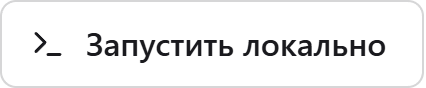
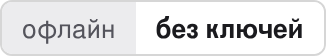
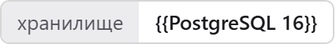
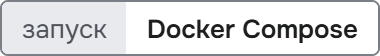
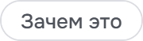
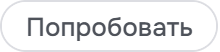
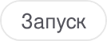
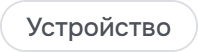
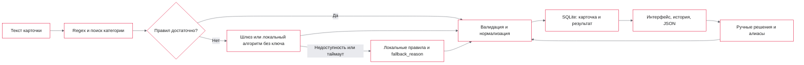

<p align="center">
  <picture>
    <source media="(prefers-color-scheme: dark)" srcset="docs/readme/banner.dark.png">
    
  </picture>
</p>

<p align="center">
  Приложение читает карточку продавца и возвращает категорию и нормализованные характеристики. У каждого
  значения есть точная цитата из текста, балл подтверждения и источник, а спорное решает человек.
</p>

<p align="center">
  <!-- readme:buttons -->
  <a href="#запуск"><picture><source media="(prefers-color-scheme: dark)" srcset="docs/readme/cta-run.dark.png"></picture></a>
  <br>
  <a href="docs/walkthrough.md"><picture><source media="(prefers-color-scheme: dark)" srcset="docs/readme/cta-walkthrough.dark.png"></picture></a>
  <a href="docs/README.md"><picture><source media="(prefers-color-scheme: dark)" srcset="docs/readme/cta-docs.dark.png"></picture></a>
  <!-- /readme:buttons -->
</p>

<p align="center">
  <!-- readme:status -->
  <a href="#результаты"><picture><source media="(prefers-color-scheme: dark)" srcset="docs/readme/badge-status-1.dark.png"></picture></a>
  <a href="#как-это-работает"><picture><source media="(prefers-color-scheme: dark)" srcset="docs/readme/badge-status-2.dark.png"></picture></a>
  <br>
  <a href="#запуск"><picture><source media="(prefers-color-scheme: dark)" srcset="docs/readme/badge-status-3.dark.png"></picture></a>
  <a href="LICENSE"><picture><source media="(prefers-color-scheme: dark)" srcset="docs/readme/badge-status-4.dark.png"></picture></a>
  <!-- /readme:status -->
</p>

<p align="center">
  <!-- readme:stack -->
  <picture><source media="(prefers-color-scheme: dark)" srcset="docs/readme/badge-stack-1.dark.png"></picture>
  <picture><source media="(prefers-color-scheme: dark)" srcset="docs/readme/badge-stack-2.dark.png"></picture>
  <br>
  <picture><source media="(prefers-color-scheme: dark)" srcset="docs/readme/badge-stack-3.dark.png"></picture>
  <picture><source media="(prefers-color-scheme: dark)" srcset="docs/readme/badge-stack-4.dark.png"></picture>
  <!-- /readme:stack -->
</p>

<p align="center">
  <!-- readme:nav -->
  <a href="#зачем-это"><picture><source media="(prefers-color-scheme: dark)" srcset="docs/readme/badge-nav-1.dark.png"></picture></a>
  <a href="#как-это-работает"><picture><source media="(prefers-color-scheme: dark)" srcset="docs/readme/badge-nav-2.dark.png"></picture></a>
  <a href="#попробовать-за-две-минуты"><picture><source media="(prefers-color-scheme: dark)" srcset="docs/readme/badge-nav-3.dark.png"></picture></a>
  <br>
  <a href="#результаты"><picture><source media="(prefers-color-scheme: dark)" srcset="docs/readme/badge-nav-4.dark.png"></picture></a>
  <a href="#запуск"><picture><source media="(prefers-color-scheme: dark)" srcset="docs/readme/badge-nav-5.dark.png"></picture></a>
  <a href="#устройство"><picture><source media="(prefers-color-scheme: dark)" srcset="docs/readme/badge-nav-6.dark.png"></picture></a>
  <a href="#ограничения"><picture><source media="(prefers-color-scheme: dark)" srcset="docs/readme/badge-nav-7.dark.png"></picture></a>
  <!-- /readme:nav -->
</p>

> **Значение без цитаты в каталог не попадает.** Перед принятием код проверяет структуру ответа,
> категорию, принадлежность поля схеме, точную цитату, отрицания, числа, единицы и диапазоны.
> Неподтверждённое значение уходит в `rejections`, поле остаётся пустым.

## Зачем это

Продавцы описывают товар свободным текстом, а каталогу нужны поля по схеме категории: диагональ,
объём памяти, цвет. Если заполнять их языковой моделью напрямую, она уверенно подставляет значения,
которых в тексте нет, и проверить это потом нельзя.

Admit заполняет только то, что подтверждено текстом. Простые случаи разбирают правила, модель
вызывается, когда правил не хватает, а каждое значение проходит одну и ту же проверку свидетельства.
Человек подтверждает, отклоняет или правит значение, и это решение применяется при повторной
обработке той же карточки.

## Как это работает



- **Правила первыми.** `RULES_FIRST=true` проверяет, хватает ли результата правил, и только тогда
  обходится без модели. Когда модели нужно ответить, её ответ сверяется с JSON Schema целиком.
- **Цитата — условие принятия.** Значение принимается, только если цитата дословно есть в тексте,
  относится к нужному объекту и не противоречит числам и единицам. Канонизация сохраняет исходную
  цитату и её позиции.
- **Шлюз может упасть, результат останется.** При недоступности или таймауте провайдера срабатывают
  локальные правила, а интерфейс явно показывает причину `fallback_reason`.
- **Решение человека сохраняется.** Ручное решение и алиас записываются одной транзакцией в SQLite;
  история открывается без нового вызова модели.

Подробно — [архитектура](docs/architecture.md), [решения реализации](docs/design-decisions.md) и
[когда вызывается модель](docs/model-routing.md).

## Попробовать за две минуты

После [запуска](#запуск) откройте <http://localhost:8080>.

| Шаг | Что сделать | Что увидите |
|---|---|---|
| 1 | Выберите пример карточки и нажмите «Извлечь атрибуты» | Кандидатов категорий во время обработки, затем выбранную категорию |
| 2 | Откройте значение | Балл подтверждения, причины оценки и цитату, подсвеченную в исходном тексте |
| 3 | Измените, отклоните или подтвердите значение | Строка обновится без нового извлечения, отклонённое можно восстановить |
| 4 | Добавьте пропущенную характеристику с цитатой | Поле появится как решение человека, без выдуманной уверенности модели |
| 5 | Нажмите «Скачать JSON» | Ввод, категорию, значения с цитатами и ручные решения в одном файле |

Полный сценарий по шагам — в [пользовательском сценарии](docs/walkthrough.md).

## Результаты

Baseline правилами обработал все **1 481 914** подготовленных карточек набора организаторов в исходном
порядке: у каждой есть запись со значениями и цитатами или явный статус пропуска, неизвестной
категории или ошибки. Проверка подтверждает полноту ID, порядок, соответствие входному тексту и позиции
цитат ([данные](docs/data.md), [воспроизводимая проверка](docs/benchmark.md)).

| Что | Масштаб |
|---|---|
| Исходные данные | 3 файла, 2,57 ГБ: описания товаров, поисковые запросы и клики, каталог |
| Полная выгрузка | 1 481 914 карточек, сжатые JSONL-части с SHA-256 в манифесте |
| Пакетный API | от 1 до 100 карточек за запрос, ограниченные очередь и параллелизм |
| EDA | [notebook](notebooks/eda.ipynb), [сводка](reports/eda.json) и графики в [`docs/images/eda`](docs/images/eda) |

<p align="center">
  
  <br>
  <sub>Насколько эталонные значения встречаются в тексте карточки дословно: от этого зависит, что можно подтвердить цитатой.</sub>
</p>

**Где граница.** Полная выгрузка проверяет исполнение правил на всём наборе, а не точность внешней
модели. Качество текущего шлюза на независимой выборке не измерено.

## Запуск

```bash
docker compose up --build -d --wait
```

Интерфейс — <http://localhost:8080>, API — <http://localhost:8000/docs>. Миграции и синтетический
демо-каталог загружаются автоматически, данные организаторов не нужны. Без ключа работают локальные
правила.

Чтобы подключить модель, создайте `.env` по образцу [`.env.example`](.env.example) и задайте
`GATEWAY_URL`, `GATEWAY_API_KEY` и `GATEWAY_MODEL` любого OpenAI-совместимого шлюза.

<details>
<summary><b>Быстрая проверка API и полное воспроизведение</b></summary>
<br>

Синтетическая карточка через запущенный API, без вызова модели:

```bash
cat > /tmp/admit-input.jsonl <<'JSONL'
{"id":"demo-1","title":"Смартфон Север S1 256 ГБ","description":"Цвет: черный. Диагональ: 6,5 дюйма. Аккумулятор: 5000 мАч."}
JSONL
python3 scripts/predict_dataset.py --base-url http://localhost:8080 \
  --input /tmp/admit-input.jsonl --output /tmp/admit-repeat/predictions.jsonl
```

Полный расчёт требует исходных файлов организаторов (`sku_desc.parquet`, `query_clicks.parquet`,
`skus.pkl`):

```bash
python3 scripts/package_dataset.py --source /path/to/raw --output artifacts/source
bash scripts/reproduce_case.sh data/reproduced-v1
```

Команда восстанавливает исходники, готовит данные, выполняет EDA, строит полный baseline и проверяет
предсказания в новом каталоге. Подробности — в [воспроизводимости](docs/reproducibility.md), команды
тестов — в [проверках](docs/verification.md).

</details>

## Устройство

```text
backend/        FastAPI: domain, usecase, repository, adapter, controller; SQLite и миграции
frontend/       интерфейс на React 19 и TypeScript
scripts/        подготовка данных, воспроизведение, пакетные предсказания, экспорт
notebooks/      EDA
reports/        сводка EDA и манифест подготовки данных
docs/           архитектура, API, решения, данные и проверки
```

| Документ | Что внутри |
|---|---|
| [Архитектура](docs/architecture.md) | Пайплайн, слои, состояние и восстановление |
| [API](docs/api.md) | Контракт результата, ошибки, порог принятия |
| [Решения реализации](docs/design-decisions.md) | Проверка результата, хранение, обратная связь |
| [Масштабирование](docs/scaling.md) | Пакетная обработка, нагрузка и порог |
| [Экспорт](docs/export.md) | Формат скачиваемой карточки |
| [Данные](docs/data.md) | Исходные файлы, подготовка и EDA |
| [Оглавление](docs/README.md) | Все страницы документации |

## Ограничения

- **Балл подтверждения — эвристика, а не вероятность правильности.** `AUTO_ACCEPT=false` отправляет
  все новые значения на ручную проверку.
- **Качество внешней модели не измерено.** Полная выгрузка сделана правилами и проверяет исполнение,
  а не точность шлюза на независимой выборке.
- **Демо-каталог ограничен.** Полный EDA и обработка всего набора запускаются командой воспроизведения
  и требуют данных организаторов.
- **Данные организаторов в репозиторий не входят.** Реальные проверочные карточки и полные
  предсказания хранятся отдельно.

<p align="center">
  <picture><source media="(prefers-color-scheme: dark)" srcset="docs/readme/mark.dark.png"></picture>
  <br>
  <sub>Команда GoatWhistle, хакатон «Точка сборки», кейс М.Видео, 2026. Лицензия <a href="LICENSE">MIT</a>.</sub>
</p>
