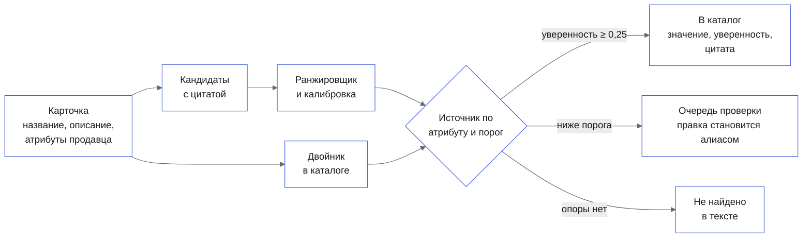
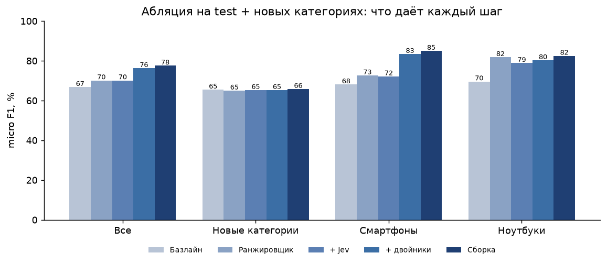

<p align="center">
  <picture>
    <source media="(prefers-color-scheme: dark)" srcset="docs/readme/banner.dark.png">
    
  </picture>
</p>

<p align="center">
  Команда каталога маркетплейса вставляет карточку продавца и получает обязательные характеристики
  в едином формате: значение, уверенность и место в тексте, откуда оно взято.
</p>

<p align="center">
  <!-- readme:buttons -->
  <a href="#запуск"><picture><source media="(prefers-color-scheme: dark)" srcset="docs/readme/cta-run.dark.png"></picture></a>
  <a href="docs/README.md"><picture><source media="(prefers-color-scheme: dark)" srcset="docs/readme/cta-docs.dark.png"></picture></a>
  <!-- /readme:buttons -->
</p>

<p align="center">
  <!-- readme:status -->
  <a href="#результаты"><picture><source media="(prefers-color-scheme: dark)" srcset="docs/readme/badge-status-1.dark.png"></picture></a>
  <a href="#запуск"><picture><source media="(prefers-color-scheme: dark)" srcset="docs/readme/badge-status-2.dark.png"></picture></a>
  <br>
  <a href="docs/running.md"><picture><source media="(prefers-color-scheme: dark)" srcset="docs/readme/badge-status-3.dark.png"></picture></a>
  <picture><source media="(prefers-color-scheme: dark)" srcset="docs/readme/badge-status-4.dark.png"></picture>
  <a href="LICENSE"><picture><source media="(prefers-color-scheme: dark)" srcset="docs/readme/badge-status-5.dark.png"></picture></a>
  <!-- /readme:status -->
</p>

<p align="center">
  <!-- readme:stack -->
  <picture><source media="(prefers-color-scheme: dark)" srcset="docs/readme/badge-stack-1.dark.png"></picture>
  <picture><source media="(prefers-color-scheme: dark)" srcset="docs/readme/badge-stack-2.dark.png"></picture>
  <picture><source media="(prefers-color-scheme: dark)" srcset="docs/readme/badge-stack-3.dark.png"></picture>
  <br>
  <picture><source media="(prefers-color-scheme: dark)" srcset="docs/readme/badge-stack-4.dark.png"></picture>
  <picture><source media="(prefers-color-scheme: dark)" srcset="docs/readme/badge-stack-5.dark.png"></picture>
  <!-- /readme:stack -->
</p>

<p align="center">
  <!-- readme:nav -->
  <a href="#зачем-это"><picture><source media="(prefers-color-scheme: dark)" srcset="docs/readme/badge-nav-1.dark.png"></picture></a>
  <a href="#как-это-работает"><picture><source media="(prefers-color-scheme: dark)" srcset="docs/readme/badge-nav-2.dark.png"></picture></a>
  <a href="#попробовать-за-две-минуты"><picture><source media="(prefers-color-scheme: dark)" srcset="docs/readme/badge-nav-3.dark.png"></picture></a>
  <br>
  <a href="#результаты"><picture><source media="(prefers-color-scheme: dark)" srcset="docs/readme/badge-nav-4.dark.png"></picture></a>
  <a href="#запуск"><picture><source media="(prefers-color-scheme: dark)" srcset="docs/readme/badge-nav-5.dark.png"></picture></a>
  <a href="#устройство"><picture><source media="(prefers-color-scheme: dark)" srcset="docs/readme/badge-nav-6.dark.png"></picture></a>
  <a href="#ограничения"><picture><source media="(prefers-color-scheme: dark)" srcset="docs/readme/badge-nav-7.dark.png"></picture></a>
  <!-- /readme:nav -->
</p>

<p align="center">
  <picture><source media="(prefers-color-scheme: dark)" srcset="docs/images/hero.dark.png"></picture>
  <br>
  <sub>Стенд на пакете из тестовой выборки, 2026-10-15: пример «Смартфон HONOR 400 12+256Gb черный», кнопка «Извлечь атрибуты». У каждого значения — уверенность, ступень и цитата; «Поддержка стандартов» и «Серия» помечены «Не найдено в тексте».</sub>
</p>

> **Значение попадает в карточку только с опорой: цитатой из текста карточки или ссылкой на
> двойника из каталога.** Кандидат без найденного в тексте фрагмента не создаётся
> (`test_candidates_carry_quotes_and_pick_expected_values` сверяет каждую цитату со срезом текста),
> decision-модель выбирает только из готовых вариантов, а значение ниже порога уверенности уходит
> человеку в очередь проверки, а не в каталог.

## Зачем это

Продавцы заполняют карточки неровно: в тестовой выборке обязательные атрибуты категории заполнены
в структурированных полях продавца только у **25,9%** пар «карточка × атрибут», остальное спрятано в
свободном тексте или отсутствует ([доказательства](docs/evidence.md#что-даёт-итоговая-сборка)).
Незаполненный атрибут выводит товар из фильтров поиска. Прямой вызов LLM на каждую карточку дорог и
придумывает значения, которых в карточке нет.

На карточке «Смартфон HONOR 400 12+256Gb черный» пайплайн находит в тексте «256 ГБ», «6,55 дюйма» и
«6000 мАч», приводит их к формату каталога и отдаёт с уверенностью и цитатой. Чего в тексте нет —
поддержки стандартов и серии — он не заполняет, а помечает «Не найдено в тексте». На тестовой
выборке обязательные атрибуты заполнены у **79,0%** пар при точности **83,3%**.

## Как это работает



<table>
<tr>
<td valign="top" width="33%">

**1. Кандидаты с цитатой и калиброванный ранжировщик**

Справочники значений из эталона train, правила «число + единица» и «ключ: значение», словари брендов
и цветов находят кандидатов; у каждого есть фрагмент текста. CatBoost выбирает кандидата,
isotonic-калибровка превращает балл в вероятность.

<sub>ECE итоговой уверенности 0,021; при уверенности 0,9–1,0 точность 98,3% — [доказательства](docs/evidence.md#что-даёт-итоговая-сборка)</sub>

</td>
<td valign="top" width="33%">

**2. Двойники в каталоге дают значения, которых нет в тексте**

Тот же товар часто уже лежит в каталоге с заполненными характеристиками. Поиск соседей по
символьным n-граммам названия с совпадением бренда и чисел переносит их в пустые слоты, со ссылкой на
SKU двойника и сходством.

<sub>+11,9 п. п. recall сверх потолка текста; точность переноса 76,2% — [доказательства](docs/evidence.md#что-дают-двойники-из-каталога-поверх-ранжировщика)</sub>

</td>
<td valign="top" width="33%">

**3. Источник выбирается по атрибуту, на валидации**

Для каждой пары «атрибут × известная или новая категория» на val выбран лучший источник: базлайн,
ранжировщик, двойник или decision-модель TypeSafe Jev, которая отвечает выбором из вариантов, а не
текстом. Test в выборе не участвует.

<sub>Правило записано в план валидации до прогона на test — [план валидации](docs/validation-plan.md)</sub>

</td>
</tr>
</table>

## Попробовать за две минуты

После [запуска](#запуск) — http://localhost:8080. Входа нет.

| | Что сделать | Что увидите |
|---|---|---|
| 1 | «Пример из тестовой выборки» → «Смартфон HONOR 400 12+256Gb черный» → «Извлечь атрибуты» | Таблица: бренд HONOR 99%, встроенная память 256 ГБ 100%, ёмкость аккумулятора 6000 мАч 99%, у каждого — источник и цитата, подсвеченная в тексте карточки |
| 2 | Посмотрите строку под таблицей | «Не найдено в тексте: Поддержка стандартов и Серия» — значений, которых нет в карточке, система не пишет |
| 3 | Пример «Смартфон Apple iPhone 16 Pro Max 512GB» → извлечь → в «Очереди проверки» исправьте «eSim» на «1 nano-SIM/1 eSim» | Повторное извлечение той же карточки возвращает «1 nano-SIM/1 eSim» с уверенностью 97% и источником «Подтверждено человеком» |

Полный маршрут, что доказывает каждый шаг и где ответ на каждый пункт ТЗ — в
[маршруте для жюри](docs/for-jury.md) и [карте требований](docs/requirements-map.md).

## Результаты

Оценка на 25 550 карточках test и восьми отложенных целиком категорий (191 236 пар «карточка ×
обязательный атрибут»), эталон — нормализованные параметры каталога `*_search`, которых нет во входе.
Правила, пороги и выбор источников подбирались только на val (24 084 карточки) и записаны в
[план валидации](docs/validation-plan.md) до прогона на test; прогон 2026-10-15.

<p align="center">
  
</p>

| Метрика | Сборка | Базлайн: справочники и правила | Порог из плана |
|---|---|---|---|
| Micro F1 по обязательным атрибутам | **77,5** | 66,8 | ≥ 0,5 |
| F1, взвешенный по трафику категорий | **80,6** | 76,4 | публикуется рядом с невзвешенным |
| Покрытие обязательных атрибутов | **79,0%** | 25,9% у продавцов, 69,1% у базлайна | не ниже покрытия у продавцов |
| Micro F1: хвост категорий / мелкие продавцы | **77,9 / 69,9** | 66,5 / 65,1 | не ниже всего набора больше чем на 15 п. п. |
| Смартфоны / ноутбуки, micro F1 | **85,0 / 82,5** | 68,1 / 69,6 | — |
| ECE итоговой уверенности | **0,021** | не калибрована | — |
| Стоимость Jev на 1 млн карточек | **≈ $62** | $0, без модели | публикуется рядом с выигрышем |

Стоимость Jev — сумма `usage.cost` по 8 000 карточкам выборки ($0,495), в модель ушли 28% слотов.

**Где проигрываем.** На восьми новых категориях сборка лишь возвращается к уровню базлайна: micro
F1 65,8 против 65,5, взвешенный 75,4 против 75,8. Атрибут «Модель» у смартфонов (83,3) и ноутбуков
(74,0) хуже базлайна (97,7 и 94,9), цвет ноутбуков хуже ранжировщика (58,2 против 69,3): двойники
переносят цвета других вариантов товара. Jev поверх ранжировщика F1 не поднимает (70,3 → 70,3 на
выборке), его вероятности переуверены (ECE 0,34).

<details>
<summary><b>Пересчитать все числа раздела</b></summary>
<br>

Из `backend/`, после [подготовки данных](docs/running.md#как-подготовить-данные):

```bash
uv run baseline --data ../data/processed --out ../data/predictions --reports ../reports
uv run ranker --data ../data/processed --out ../data/predictions --reports ../reports
uv run twins --data ../data/processed --out ../data/predictions --reports ../reports
uv run final --data ../data/processed --out ../data/predictions --reports ../reports --model ../data/models/fusion
```

Полная последовательность для сборки (ранжировщик с сохранённой моделью и предсказаниями на val,
двойники на val и test, Jev из кэша) — в [запуске](docs/running.md#итоговая-сборка-и-файл-предсказаний-по-всем-карточкам).
Без сети и платных ключей: Jev отвечает из кэша `data/decision_cache/` или пропускается. Отчёты
пишутся в `reports/` (`baseline.md`, `ranker.md`, `twins.md`, `final.md`). Сборка — около 20 минут
и 2,3 ГБ памяти, ранжировщик — около 20 минут и 3 ГБ.

</details>

## Запуск

Стенд — Docker и Compose v2, из корня:

```bash
cd backend && uv run stand-pack --data ../data/processed --out ../data/stand/pack.json.gz && cd ..
docker buildx bake
docker compose up
```

Интерфейс — http://localhost:8080, API — http://localhost:8000, Swagger — http://localhost:8000/docs.
Пакет стенда (~2 МБ) собирается из подготовленных данных за ~2 минуты; без него страница показывает
ошибку с подсказкой собрать пакет. Ключи не нужны. Первая сборка образов требует сети.

**Данные.** Архив организаторов `dataset.zip` (1,1 ГБ) в git не хранится. SHA-256:
`28758293f1174b2f19adcf2c99a86a9b5d2094aa22f3bbc92538af7180b59043`.

```bash
sha256sum dataset.zip
unzip dataset.zip -d data/raw
cd backend
uv run prepare-data --raw ../data/raw --out ../data/processed
```

Подготовка — около 11 минут и 5,2 ГБ памяти, без сети.

<details>
<summary><b>Файл предсказаний по всем карточкам, разработка, проверки, переменные</b></summary>
<br>

Файл предсказаний по всем 1 177 200 карточкам (`data/predictions/final_all.predictions.jsonl`): сначала
категории для карточек вне каталога, затем ступени сборки и шардированный прогон, не больше трёх
процессов одновременно:

```bash
cd backend
uv run infer-categories --data ../data/processed --raw ../data/raw --reports ../reports
STAGE=final WORK=../data/fusion_shards bash scripts/predict-all.sh ../data/processed ../data/predictions
```

`STAGE=final` требует моделей ранжировщика и сборки — команды в
[запуске](docs/running.md#итоговая-сборка-и-файл-предсказаний-по-всем-карточкам). Формат строки:
`{sku_id, category_id, split, confidence_calibrated, attributes: {атрибут: {value, confidence, source,
evidence, start, end}}, review}`.

Без Docker: `cd backend && STAND_PACK=../data/stand/pack.json.gz uv run uvicorn app.main:create_app --factory`
и `cd frontend && npm ci && npm run dev`.

Проверки: `cd backend && uv run ruff check . && uv run mypy . && uv run pytest tests/unit`;
`cd frontend && npm run verify`. Decision-модель необязательна: `DECISION_MODEL=system_one`,
`DECISION_MODEL_URL=https://openrouter.ai/api`, `DECISION_MODEL_NAME=typesafe/jev-1.13`,
`DECISION_MODEL_API_KEY`. Все переменные — в [запуске и проверках](docs/running.md).

</details>

## Устройство

Стенд — React-страница и FastAPI-бэкенд; пайплайн извлечения — те же модули Python, что и офлайн-команды.
Ключевое решение — выбор источника значения и порог уверенности — принимает сборка
(`backend/src/app/domain/fusion.py`) по правилу, подобранному на val.

| Документ | Что внутри |
|---|---|
| [Архитектура](docs/architecture.md) | Части стенда, путь карточки через пайплайн, слои бэкенда, что заменяется без правки кода |
| [API](docs/api.md) | Методы стенда, формат ошибок; OpenAPI генерируется из кода |
| [Зависимости](docs/dependencies.md) | Библиотеки и модели с версиями и лицензиями |
| [Глоссарий](docs/glossary.md) | Термины предметной области, одно понятие — одно слово |
| [Разведочный анализ](notebooks/eda.ipynb) | Поля, пропуски, распределения, длинный хвост, связка файлов |
| [Оглавление](docs/README.md) | Все страницы и где ответ на каждый пункт ТЗ о документации |

## Ограничения

- **Эталон — параметры каталога `*_search`, а не разметка людьми.** Организаторы обещали размеченную
  часть, в архиве её нет; метрики меряют совпадение с нормализованными фильтрами каталога, а
  ошибки самого каталога считаются ошибками решения.
- **Новые категории — на уровне базлайна.** На восьми отложенных категориях micro F1 65,8 против
  65,5 у правил: у ранжировщика нет частот значений, двойников в индексе нет по построению.
- **Карточки вне каталога не оценены.** Категория для 697 тыс. таких карточек восстановлена
  классификатором (на test top-1 98,1%), но точность категорий и атрибутов на них не измерена:
  эталона нет. Очередь проверки стенда хранится в памяти процесса и сбрасывается при перезапуске.

Все ограничения, со статусом и тем, что закрыло бы каждое, — в [ограничениях](docs/limitations.md).

<!-- scrub:start -->
## Для команды

Этот блок вырезается при сдаче вместе с маркерами `scrub:start` и `scrub:end`.

1. `bash .claude/scripts/setup.sh` — один раз на клон: хуки коммитов и ссылки на общий каталог `skills/`.
2. Визуал README: `cd presentation && npm run readme` пересобирает `docs/readme/*.png` из
   `presentation/readme/assets.html` и `presentation/readme/readme.json` (Chrome — через `CHROME_PATH`).
3. Числа в «Результатах» и бейджах берутся из `reports/final.md` и `docs/evidence.md`; после
   пересчёта отчёта они обновляются вместе.
4. Покрытие файла по всем карточкам обновится после переноса двойников на все карточки.
5. Перед защитой: `bash .claude/scripts/strip-ai.sh` показывает на копии, что будет удалено.
<!-- scrub:end -->

<p align="center">
  <picture><source media="(prefers-color-scheme: dark)" srcset="docs/readme/mark.dark.png"></picture>
  <br>
  <sub>Команда GoatWhistle, продуктовый хакатон «Точка сборки», 2026.</sub>
</p>
