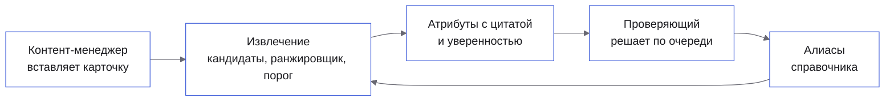
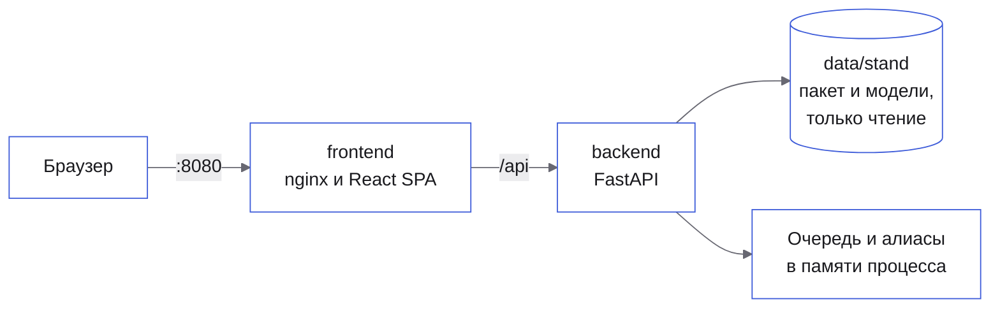
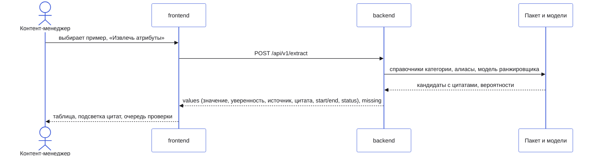

# Архитектура

> Решение — две части: офлайн-пайплайн (команды Python над данными организаторов) и стенд
> (React-страница и FastAPI-бэкенд) на тех же модулях извлечения. Главная граница системы: значение
> рождается только из фрагмента текста карточки или из карточки-двойника в каталоге, а модели —
> ранжировщик и decision-модель — лишь выбирают среди готовых кандидатов и оценивают уверенность.
> Поэтому основной сценарий работает без сети и ключей. Здесь — роли, части, путь карточки, слои и
> то, что заменяется без правки сценариев.

**Читайте, если** вы проверяете техническую проработку или добавляете код · **Связано:**
[API](api.md) · [зависимости](dependencies.md) · [запуск](running.md)

---

## Кто что делает в системе?



| Роль | Что делает | Где проверяются права |
|---|---|---|
| Контент-менеджер | Вставляет карточку или выбирает пример, запускает извлечение | Входа нет: стенд — одна страница без авторизации ([ADR 0005](adr/0005-stand-scope.md)) |
| Проверяющий | Принимает или исправляет значения ниже порога в очереди проверки | Там же; очередь общая для всех, кто открыл стенд |
| Система | Ищет кандидатов, выбирает значение, калибрует уверенность, решает по порогу, где оно окажется | `backend/src/app/usecase/extract_card.py`, `backend/src/app/domain/fusion.py` |

## Из каких частей собран стенд?



| Контейнер | Образ | Роль |
|---|---|---|
| `frontend` | `node:22-alpine` → `nginx:1.27-alpine` | Сборка SPA, раздача статики, прокси `/api` на бэкенд |
| `backend` | `python:3.12-slim` | API стенда и извлечение; проверка здоровья — `GET /api/v1/health` |

Базы данных нет. Пакет стенда (`pack.json.gz`, ~2 МБ: справочники, обязательные атрибуты, примеры)
и модели ранжировщика и сборки монтируются из `./data/stand` только для чтения. Очередь проверки и
алиасы живут в памяти процесса бэкенда: перезапуск их сбрасывает.

Офлайн-пайплайн — команды `uv run` в `backend/`: `prepare-data` → `baseline` → `ranker` → `twins` →
`decide` → `final`, плюс `infer-categories` и шардированный прогон по всем карточкам
(`scripts/predict-all.sh`). Порядок и ресурсы — в [запуске](running.md).

## Как проходит основной сценарий?



Ключевое решение принимается после ранжировщика: сборка (`backend/src/app/domain/fusion.py`)
калибрует уверенность источника и сравнивает её с порогом. Выше порога значение получает статус «В
каталоге», ниже — «На проверке» и `review_id`. Кандидата без фрагмента текста не существует: это
закрепляет `test_candidates_carry_quotes_and_pick_expected_values`, а
`test_values_below_the_fused_threshold_go_to_review` — что значение ниже порога не принимается.

## Как устроен бэкенд?

```text
backend/src/app/
  domain/       значения и нормализация, кандидаты, метрики, калибровка, сборка, двойники, очередь
  usecase/      сценарии: подготовка данных, базлайн, ранжировщик, двойники, decision-модель, сборка, стенд; порты
  adapter/      parquet и потоковый разбор каталога, CatBoost и isotonic, TF-IDF, System One, файлы пакета
  repository/   очередь проверки и алиасы в памяти
  controller/   HTTP: health и стенд, формат ошибок
  main.py       сборка приложения; run_*.py — точки входа офлайн-команд
```

| Слой | Что в нём | Чего ему нельзя |
|---|---|---|
| `domain` | Значения, кандидаты, метрики, правила сборки | Импортировать фреймворк, файлы, HTTP |
| `usecase` | Сценарии и порты (`CandidateChooser`, `ReviewRepository`, `DecisionModel`, `TitleIndex`) | Знать о конкретных реализациях |
| `adapter`, `repository` | Реализации портов: parquet, CatBoost, TF-IDF, HTTP-модель, память | Содержать правила предметной области |
| `controller` | Роутеры FastAPI, схемы запросов и ответов | Содержать правила предметной области |

Направление зависимостей проверяет `test_layers_follow_dependency_rule`
(`backend/tests/unit/architecture/test_dependency_rule.py`).

## Как устроен фронтенд?

```text
frontend/src/
  app/        провайдеры, маршруты, оболочка
  pages/      экран — композиция фич, без своей логики
  features/   извлечение карточки, очередь проверки
  entities/   данные стенда и запросы
  shared/     клиент API, примитивы интерфейса, движение, словари RU и EN, токены
```

Импорты идут только вниз: `app → pages → features → entities → shared`. Типы API генерируются из
OpenAPI бэкенда. Тексты интерфейса — только из словарей RU и EN. Стенд — на `/`, служебная страница
шаблона — на `/status`.

## Что заменяется без правки сценариев?

| Порт | Реализация на стенде | Запасной путь | Как переключить |
|---|---|---|---|
| `CandidateChooser` | Ранжировщик и правило сборки из `data/stand/models` | Эвристика базлайна, если моделей нет (лог `stand_models_missing`) | `STAND_MODELS` |
| `DecisionModel` | Не используется на стенде; офлайн — TypeSafe Jev по контракту `/v1/systemone` | `lexical` — детерминированная офлайн-замена | `DECISION_MODEL`, `DECISION_MODEL_URL`, `DECISION_MODEL_NAME` |
| `ReviewRepository`, `AliasRepository` | Память процесса | — | Код в `repository/` |

В офлайн-команде `decide` адаптер повторяет запрос до трёх раз при 429 и 5xx; когда сумма
`usage.cost` достигает `--max-cost-usd`, оставшиеся карточки получают значения базлайна.

## Куда класть новый код?

| Что добавляется | Куда | Образец |
|---|---|---|
| Новое правило извлечения или нормализации | `backend/src/app/domain/` | `backend/src/app/domain/extractors.py`, `values.py` |
| Новая ступень пайплайна | `backend/src/app/usecase/` + точка входа `run_*.py` | `backend/src/app/usecase/twins.py`, `run_twins.py` |
| Новый метод API | `backend/src/app/controller/stand/` | `backend/src/app/controller/stand/router.py` |
| Новый экран | `frontend/src/pages/` | `frontend/src/pages/stand/stand-page.tsx` |

---

<sub>[Оглавление документации](README.md) · [README проекта](../README.md)</sub>
