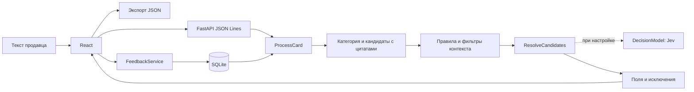

# Архитектура

Каталогизатор вставляет текст продавца в одностраничный стенд без авторизации. React получает
реальные события FastAPI и показывает заполненные поля, цитаты и исключения. Жизненный цикл
стенда использует SQLite: каталог, исправления и алиасы переживают перезапуск. Выбор хранилища
зафиксирован в [ADR 0006](adr/0006-sqlite-feedback.md).

- `domain/`: текст, единицы, профили, кандидаты, контекст, оценки, метрики. Только стандартная библиотека.
- `usecase/`: извлечение, фоновое разрешение кандидатов, baseline и аудит; зависимости через порты.
- `adapter/catalog/`: чтение конфигурации словаря. Демо-конфигурация явно помечена synthetic.
- `adapter/dataset/`: чтение parquet и запись артефактов оценки.
- `adapter/decision/`: TypeSafe System One и детерминированный fallback.
- `repository/sqlite/`: SQL через aiosqlite, dataclass DTO на портах, транзакции через Unit of Work.
- `controller/`: Pydantic на HTTP-границе, FastAPI-роуты и ошибки.
- `main.py`: сборка зависимостей и закрытие HTTP-клиента модели.

Compose содержит frontend с nginx и backend. nginx отключает буферизацию `/api` для передачи событий.
Frontend использует сгенерированные типы OpenAPI, openapi-fetch и TanStack Query. Отмена страницы
прерывает поток; повторный запуск сбрасывает прежний результат. Кэш результатов Jev живёт только
в процессе и теряется при перезапуске. SQLite хранится в именованном томе `catalog-data`;
`storage-init` готовит права, `migrate` применяет dbmate SQL, `seed` вызывает use case загрузки
каталога. Backend стартует после успешного seed. Обработчики запросов не создают схему.

UoW открывает транзакцию с `BEGIN IMMEDIATE`, включает foreign keys и busy timeout; WAL включается
отдельной миграцией. Выход без commit откатывает изменения. Ограничения и сериализация записей
защищают идемпотентность, уникальность активной правки и отмену по версии. Сетевые обращения к
модели выполняются вне транзакции.

[Алгоритм и пределы](automatic-catalog.md), [контракт API](api.md), [запуск](running.md).

## Совместимость и экспериментальные ступени

Сохранены из main CatBoost/isotonic, пакетный Jev и twins, вместе с историческими отчётами.
Они не подключаются автоматически к новому стенду без повторной оценки на новых кандидатах.
Старый синхронный API `/extract` и экран `/manual` используют STAND_PACK и временную очередь.
Основной экран `/` использует `/extract/stream` и постоянное хранилище SQLite.
