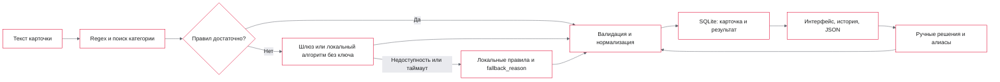

# Архитектура

Основной маршрут `POST /api/v1/extract` выполняет реальное извлечение и
сохраняет JSON результата в SQLite. И одиночный запрос, и пакет используют
одни сценарии валидации, принятия и ручной обратной связи.

## Где реализованы основные действия

| Действие | Реализация |
|---|---|
| Сохранение каждого ответа основного API | [controller/stand/router.py](../backend/src/app/controller/stand/router.py), `history.begin` и `history.finish` |
| Чтение сохранённого результата | [history_router.py](../backend/src/app/controller/stand/history_router.py), `GET /api/v1/runs/{run_id}` |
| Запись ручного решения и алиаса | [persistent_review.py](../backend/src/app/usecase/persistent_review.py), одна транзакция |
| Полная проверка JSON Schema ответа шлюза | [output_validation.py](../backend/src/app/adapter/llm/output_validation.py) |
| Семантическая проверка характеристики по тексту | [evidence_validation.py](../backend/src/app/domain/evidence_validation.py) |
| Сохранение отдельного файла предсказаний | [predict_dataset.py](../scripts/predict_dataset.py), обращается к основному API |
| Полная потоковая выгрузка по всем ID | [batch_predict/runner.py](../backend/batch_predict/runner.py), использует производственные функции извлечения и проверки |

## Слои

`domain` содержит значения и правила, `usecase` — сценарии и порты,
`repository` — SQLite и поиск, `adapter` — шлюз, `controller` — HTTP.
Конкретные зависимости собираются в [main.py](../backend/src/app/main.py).

Сетевые операции и SQLite асинхронные. CPU-вычисления поиска, разбора и
валидации вынесены из event loop. Размер групп, параллелизм и очередь ограничены.

## Состояние и восстановление

SQLite хранится в именованном томе `state`. Миграции и seed запускаются отдельными
Compose-сервисами до API. Перезапуск сохраняет исходные карточки, результаты,
категории и ручные решения. Незавершённые запуски помечаются `interrupted`.

Результат истории — исходный снимок. При открытии и экспорте интерфейс применяет
актуальные ручные решения без нового извлечения. Новые категории и поля сразу
доступны обеим веткам алгоритма. Каталог синхронизируется внутри одного процесса.

Недоступность провайдера вызывает локальный переход с `fallback_reason`.
Если он отключён или неприменим, ошибка провайдера возвращается отдельным кодом.
Ошибки хранилища также имеют отдельные коды.
Сбой карточки в пакете не отменяет уже завершённые карточки.
[HTTP-контракт](api.md) · [Транзакции и валидация](design-decisions.md).
