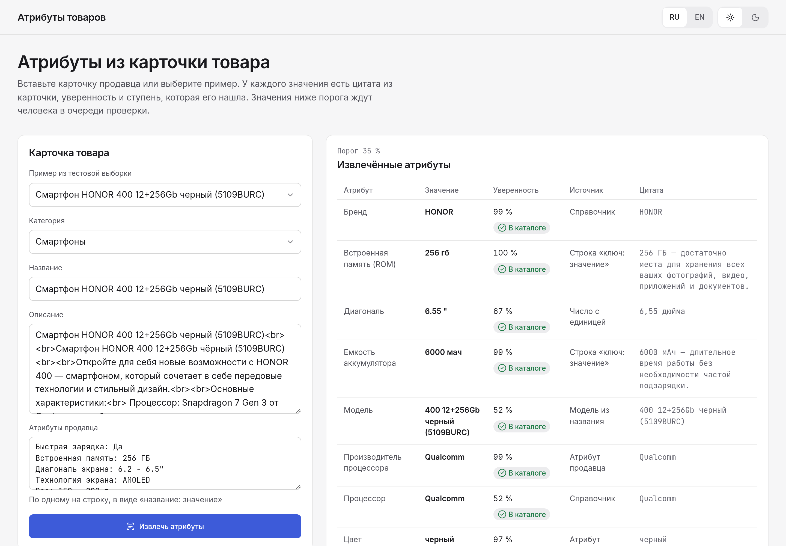

# Для жюри

> Кратчайший маршрут по стенду «Атрибуты товаров»: что открыть, что должно быть видно и что
> доказывает каждый шаг. Шаги не требуют ни регистрации, ни ключей: стенд поднимается локально
> одной командой и работает без сети. Последний раздел сопоставляет каждый пункт ТЗ о метриках и
> рисках с местом проекта, где на него ответ.

**Читайте, если** вы оцениваете решение · **Связано:** [карта требований](requirements-map.md) ·
[доказательства](evidence.md) · [ограничения](limitations.md)

---

## Где что находится?

Публичного стенда нет: стенд поднимается локально командами из [README](../README.md#запуск)
(`stand-pack`, `docker buildx bake`, `docker compose up`), подробно — в [запуске](running.md#как-поднять-стенд).
Входа нет.

| Адрес | Что это |
|---|---|
| http://localhost:8080/ | Стенд: карточка товара слева, извлечённые атрибуты и текст карточки с подсвеченными цитатами справа, очередь проверки внизу слева |
| http://localhost:8000/docs | Swagger API стенда |

## Маршрут за две минуты

Шаги повторяют задание кейса: «читает текстовую карточку товара, извлекает обязательные
характеристики, приводит их к единому формату и для каждого значения указывает уверенность» (р. 0) и
петлю обратной связи (р. 4). Маршрут пройден вручную 2026-10-15 на пакете стенда из тестовой
выборки; петля шага 4 закреплена тестом `test_review_loop_over_http`.

| # | Что сделать | Что увидеть | Что это доказывает |
|---|---|---|---|
| 1 | «Пример из тестовой выборки» → «Смартфон HONOR 400 12+256Gb черный (5109BURC)» → «Извлечь атрибуты» | Бренд HONOR 99%, встроенная память «256 гб» 100%, диагональ `6.55 "` 67%, ёмкость аккумулятора «6000 мач» 99%; у каждого значения — источник и цитата | Извлечение обязательных полей ТЗ для смартфона, нормализация («6,55 дюйма» → `6.55 "`), уверенность у каждого значения |
| 2 | Посмотрите строку под таблицей и блок «Текст карточки с цитатами» | «Не найдено в тексте: Поддержка стандартов и Серия»; найденные значения подчёркнуты в тексте карточки | Решение не выдумывает: без фрагмента текста значения нет, каждая цитата видна на своём месте |
| 3 | Пример «Смартфон Apple iPhone 16 Pro Max 512GB черный титан» → «Извлечь атрибуты» | «Поддержка SIM карт: eSim», 32%, статус «На проверке»; значение появилось в «Очереди проверки» | Значение ниже порога 35% не попадает в каталог, а уходит человеку |
| 4 | В очереди исправьте значение на «1 nano-SIM/1 eSim» и подтвердите | Карточка извлекается заново: «1 nano-SIM/1 eSim», 97%, «В каталоге», источник «Подтверждено человеком» | Петля обратной связи: решение человека становится алиасом справочника и сразу меняет результат |
| 5 | Очистите название и попробуйте извлечь | Кнопка «Извлечь атрибуты» недоступна; при остановленном бэкенде или без пакета — сообщение с подсказкой собрать пакет | Честные состояния ошибок вместо пустой таблицы |

  
   
  Шаг 1 на стенде, 2026-10-15, пакет из тестовой выборки.

**Что важно знать о демо-данных.** Пакет стенда — 30 категорий с наибольшим трафиком (смартфоны и
ноутбуки всегда) и 39 реальных карточек из test, не участвовавших в обучении. На стенде работают
базлайн и ранжировщик с калибровкой и порогом итоговой сборки; двойники и decision-модель есть
только в офлайн-пайплайне.

## Где ответ на каждый критерий?

Критерии и веса жюри организаторы не опубликовали; ниже — «Метрики успеха» и требования к защите
из ТЗ (р. 5).

### 1. Precision, recall и F1 по каждому атрибуту

| Что оценивается | Где ответ |
|---|---|
| Насколько точно и полно извлекается каждое поле, включая редкие | Micro F1 77,5, macro F1 64,7 на 191 236 парах; таблицы по атрибутам — `reports/final.md`; сводка — [доказательства](evidence.md#что-даёт-итоговая-сборка) |
| Что даёт каждый шаг: правила → модель | Абляция «базлайн → ранжировщик → + Jev → + двойники → сборка» — [README](../README.md#результаты), `docs/images/results/ablation.png` |

### 2. Покрытие

| Что оценивается | Где ответ |
|---|---|
| Насколько полнее становится каталог | Обязательные атрибуты заполнены у 79,0% пар против 25,9% в полях продавца — [доказательства](evidence.md#что-даёт-итоговая-сборка) |
| Файл предсказаний по каждой карточке | 1 177 200 карточек, 3,6 атрибута на карточку — [доказательства](evidence.md#что-даёт-итоговая-сборка) |

### 3. Качество с учётом трафика

Вес атрибута — клики категории и доля поисковых запросов, где встречается его значение. Взвешенный
F1 сборки 80,6 против 76,4 у правил — [доказательства](evidence.md#что-даёт-итоговая-сборка), метод — [план
валидации](validation-plan.md).

### 4. Оценка по категориям, включая редкие

Хвост категорий — 77,9, мелкие продавцы — 69,9, восемь новых категорий — 65,8. Человеческого
gold-сета нет, эталон — параметры каталога — [ограничения](limitations.md#эталон--параметры-каталога-а-не-разметка-людьми).

### 5. Риски и меры снижения

| Риск из ТЗ | Мера | Где видно |
|---|---|---|
| Галлюцинации LLM | Значение только с цитатой или от двойника; decision-модель выбирает из готовых вариантов | Шаг 2 маршрута, `test_not_stated_and_unknown_options_give_no_value` |
| Стоимость на масштабе | Jev только для спорных слотов: 28% слотов, ≈ $62 на 1 млн карточек; без ключа всё работает | [доказательства](evidence.md#что-даёт-decision-модель-поверх-правил) |
| Слабая оценка на длинном хвосте | Отдельные разрезы по хвосту, продавцам и новым категориям | `reports/final.md` |
| Падение на новых категориях | Отдельный режим сборки; на уровне правил, без прироста | [ограничения](limitations.md#новые-категории-извлекаются-на-уровне-правил) |

## Чего в этом checkout нет?

Сказано заранее, чтобы не стало открытием на защите:

- **Данных и файла предсказаний.** Архив организаторов (1,1 ГБ) и файл предсказаний (около 1 ГБ) в
  git не хранятся; архив проверяется по SHA-256 из [README](../README.md#запуск), файл собирается
  командами оттуда же.
- **Ответов decision-модели.** Кэш ответов Jev лежит в `data/decision_cache/` вне git; без него и без
  ключа сборка работает без decision-модели.

Полный перечень — в [ограничениях](limitations.md).

---

[Оглавление документации](README.md) · [README проекта](../README.md)
